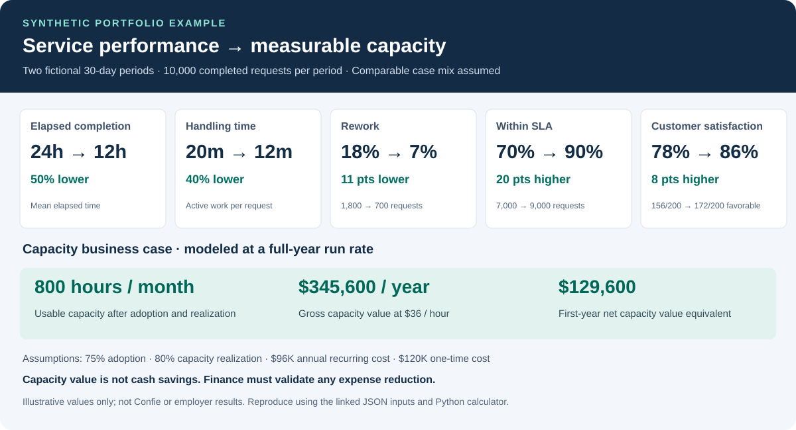

# Enterprise Reengineering & CoE Playbook

**Christopher D. Cole | Lean Six Sigma Master Black Belt**

I lead process redesign and help build the methods, ownership and measurement discipline that make transformation repeatable across business units. This portfolio combines experience from banking, insurance and consulting with practical tools for establishing a Reengineering Center of Excellence.

## Selected experience

| Engagement | My accountability | Reported outcome |
|---|---|---|
| [USAA enterprise redesign](case-studies/usaa-enterprise-reengineering.md) | Process engineering; leader alignment; requirements, controls and adoption | **25 processes / 600+ steps; 35% productivity improvement; issues resolved across 33 regions** |
| [Wells Fargo process architecture](case-studies/rcsa-process-architecture.md) | Group Process Architect; common modeling approach; BPMN training | **120 RCSA service models delivered** |
| [Booz Allen structured discovery](case-studies/structured-discovery.md) | Facilitated discovery and translated findings into implementation priorities | **62 process gaps closed across six initiatives** |

## CoE toolkit

| Executive question | Start here |
|---|---|
| What does the CoE own, and how is it staffed? | [Charter, team model and decision rights](coe-charter-and-governance.md) |
| What would I establish in the first 90 days? | [90-day launch plan](90-day-launch-plan.md) |
| Which problems should we tackle first? | [Intake and prioritization](intake-and-prioritization.md) |
| How do we find leakage and design the future state? | [Structured discovery and VSM](improvement-frameworks.md) |
| How will we prove financial and customer value? | [Metrics, dashboard and benefits model](metrics-and-operational-performance.md) |
| What decision does an executive need to make? | [One-page executive decision brief](executive-decision-brief.md) |
| How do controls and adoption survive implementation? | [Controls by design](controls-and-risk-thinking.md) · [Implementation and change](implementation-and-change-planning.md) |

## Measurement example

The dashboard below uses **synthetic insurance-service data** to demonstrate the link between process performance, customer experience and capacity. It is a portfolio example, not a result from Confie or any employer.

The [measurement guide](metrics-and-operational-performance.md) defines every metric and separates capacity value from cash savings. Reproduce the calculations using the [sample inputs](examples/benefits-inputs.json) and [calculator](examples/benefits-calculator.py).

## Operating approach

Agree the business outcome, baseline the end-to-end process, verify root causes, choose the intervention, implement with owners and controls, then validate benefits and sustain performance. Shared standards support local execution; exceptions need a reason, an owner and a review date.

**Portfolio status:** Case studies summarize experience. CoE documents and examples are proposed reusable tools. [Evidence and measurement notes](evidence-and-measurement.md) explain the boundaries of each claim.

[Profile](https://github.com/ddjfam) · [Enterprise AI enablement](https://github.com/ddjfam/agentic-ai-automation-playbook) · [Workflow automation](https://github.com/ddjfam/servicenow-workflow-automation)
