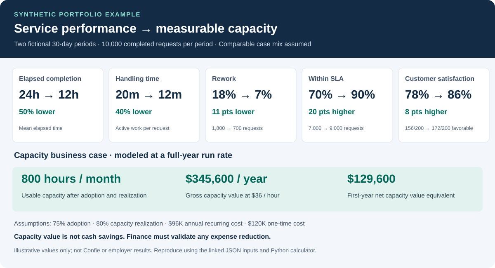

# Operational Performance and Benefits Realization

**Reusable measurement guide with a synthetic insurance-service example.**

Use data to expose leakage, select the intervention and verify the result. A dashboard should tell an owner what changed, why it matters and what decision is needed.

## Define the baseline before the business case

Agree the start/end events, unit of work, population, exclusions, measurement period and accountable owner. Reconcile volumes to the source. Segment by location, channel and request type so a change in case mix does not look like an improvement.

| Measure | Definition | Decision it supports |
|---|---|---|
| Elapsed cycle time | Completion timestamp minus accepted-intake timestamp; show median and p90 in a live deployment | Find queues and long-tail delays |
| Handling time | Total active work minutes / completed requests | Find manual effort and estimate capacity |
| Rework rate | Completed requests requiring correction / all completed requests | Identify defects and upstream causes |
| SLA attainment | In-scope requests completed within the agreed SLA / all in-scope completed requests | Focus on missed commitments |
| Customer satisfaction | Favorable survey responses / valid responses; show sample size and response rate | Check whether customers benefit |
| Adoption | Eligible transactions using the new workflow / all eligible transactions | Explain the gap between pilot and scaled value |
| Benefits realized | Observed incremental benefit accepted by the accountable owner and Finance | Decide whether to scale or adjust |

## Synthetic scorecard

The example compares two fictional 30-day periods, each with 10,000 completed requests. Case mix is assumed comparable. Cycle time here is a **mean** because the sample contains aggregate inputs; a real deployment should also show the distribution. Each synthetic survey has 200 valid responses.



| Measure | Baseline | Redesigned process | Change |
|---|---:|---:|---:|
| Mean elapsed completion time | 24 hours | 12 hours | 50% lower |
| Mean handling time | 20 minutes | 12 minutes | 40% lower |
| Rework rate | 18% | 7% | 11 percentage points lower |
| SLA attainment | 70% | 90% | 20 percentage points higher |
| Favorable survey responses | 78% (156/200) | 86% (172/200) | 8 percentage points higher |

These are illustrative values, not Confie or employer results. The small aggregate sample demonstrates calculations, not statistical significance or causation.

## Capacity model and financial treatment

The [JSON inputs](examples/benefits-inputs.json) and [Python calculator](examples/benefits-calculator.py) make the assumptions reproducible:

```text
Gross hours released / month = 10,000 requests × (20 − 12) minutes / 60
                            = 1,333.33 hours
Adoption-adjusted hours     = 1,333.33 × 75% = 1,000 hours
Usable capacity             = 1,000 × 80% = 800 hours / month
Capacity value              = 800 × $36 loaded hourly cost = $28,800 / month
Annual capacity value       = $345,600
Annual recurring cost       = $96,000
One-time implementation     = $120,000
First-year net capacity value equivalent = $129,600
```

This annual model assumes 12 months at the stated run rate; it does not include a ramp-up period. Adoption represents eligible volume using the workflow. The realization factor represents how much released time can be consolidated and put to productive use. Avoid applying either discount twice.

**Capacity value is not cash savings.** Finance would need an approved staffing, overtime or other expense action before recognizing a cash reduction. Do not add rework savings again when they are already included in the handling-time reduction. Customer, quality and control outcomes remain separate measures unless a defensible valuation is agreed.

Run from the repository root with Python 3:

```bash
python examples/benefits-calculator.py
```

## Implementation in reporting tools

| Tool | Practical use | Control |
|---|---|---|
| Power BI | Transaction and event tables, common measures, location/process drill-downs | Reconcile totals; document refresh date and metric owner |
| Tableau | Distribution, bottleneck and customer-outcome views | Use the same definitions and filters as the approved baseline |
| Excel | Assumptions, scenarios and Finance review | Separate inputs from formulas; version assumptions and approvals |
| SaaS workflow reporting | Queue, exception, SLA and adoption measures | Validate event timestamps and status definitions |

This repository contains a portable JSON/Python/SVG demonstration; the table describes how to implement the same measurement design in reporting platforms.

## Benefits register and governance

Track: initiative; sponsor; baseline date; metric definition; baseline; target; approved forecast; observed result; benefit category; costs; dependencies; owner; evidence; Finance acceptance; next review.

Review leading indicators weekly during a pilot, operational performance after launch and accepted benefits monthly. Close an initiative only when the process owner has a monitoring routine, escalation triggers and responsibility for corrective action.

[Executive decision brief](executive-decision-brief.md) · [Intake and prioritization](intake-and-prioritization.md) · [Experience measurement notes](evidence-and-measurement.md)
